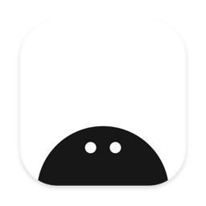

# Shy



A small browser for the Mac. It keeps to itself.

We took the best of Arc and Safari, and a few things from Chrome.

macOS 26 or later · 7.5 MB installed, 3.8 MB zipped · MIT

**Status:** feature complete. Now it's about safety, security, performance and small fixes.

## What it does

- **Tabs down the side.** Pin the ones you use every day, group the rest in folders and spaces, and keep each profile's sign-ins separate. View two pages side by side.
- **Quiet pages.** Ads and trackers are blocked before they load. Hide an element on a site for good, read without clutter, float a video.
- **Light.** Tabs you don't use go to sleep.
- **Your local agent, over MCP.** Shy isn't an AI browser. It just keeps up with the times, with the smallest set of features an agent needs. Switch on Settings › Agents, and an agent on your Mac can use the browser. It works in its own pages, in a folder you can see. You decide what it gets: share only the data you choose, or work on pages together. Your tabs and passwords stay yours. To let it use one site as you, right-click a tab and choose **Hand Over to Agent…**. That sign-in is read-only unless you say otherwise, works only on that site, and ends when the time you chose is up.

## Security

- **Small.** A thin layer over WebKit, the engine already in macOS.
- **Quiet on the network.** No account, no sync, no telemetry, no update check.
- **Passwords in the keychain**, behind Touch ID.
- **Off until you turn it on.** Anything that can reach your data, agents included, waits for you.
- **No test hooks in a release build.**

Found a hole? Report it privately, as [SECURITY.md](SECURITY.md) explains.

## Contributing

Shy is built with AI agents and reviewed by a person. Ideas and fixes are welcome: [open an issue](https://github.com/nxcco/shy/issues), or read [CONTRIBUTING.md](CONTRIBUTING.md) first to see what gets merged.

## Building

```bash
./install.sh     # build Shy and put it in /Applications
swift build      # the app and shy-mcp
./build.sh       # build/Shy.app
Tests/run.sh     # unit, smoke and security tests; `Tests/run.sh smoke` for one part
```

Shy began as a fork of [Search](https://github.com/driceroland/Search) by Office Commun. It stays small on purpose. Stay shy.

MIT, see [LICENSE](LICENSE).
